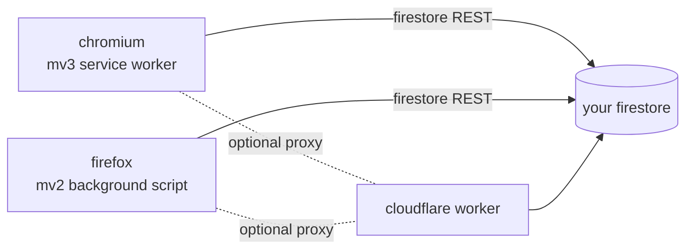

<p align="center">
  
</p>

<h1 align="center">TabSync</h1>

<p align="center">
  sync open tabs across your devices — self-hosted, no accounts<br>
  <b>chromium + firefox extension</b> · <b>your own firestore</b> · <b>remote tab control</b>
</p>

<p align="center">
  <a href="LICENSE"></a>
  <a href="https://github.com/FahadBinHussain/tabsync/releases/latest"></a>
  <a href="https://github.com/FahadBinHussain/tabsync/actions/workflows/build-release.yml"></a>
  
  
  
  <a href="https://tbsync.vercel.app"></a>
</p>

<table align="center">
  <tr>
    <td align="center" width="33%"><b>🔄 live tab sync</b><br>every tab change is written to<br>your backend, debounced 2s</td>
    <td align="center" width="33%"><b>📱 multi-device</b><br>name each device, see all their<br>open tabs, open all at once</td>
    <td align="center" width="33%"><b>🖱️ remote control</b><br>close or open a tab on another<br>device from the popup</td>
  </tr>
  <tr>
    <td align="center"><b>📚 bookmark sync</b><br>full bookmark tree follows you,<br>open a folder or import it locally</td>
    <td align="center"><b>🔌 your own firestore</b><br>bring your firebase config,<br>no auth, single-tenant by design</td>
    <td align="center"><b>🧅 tor + proxy</b><br>route firestore through your own<br>cloudflare worker when blocked</td>
  </tr>
</table>

## how it works



one popup UI, built twice per release: manifest v3 for chromium, manifest v2 for
firefox, sharing the same react + typescript source through
`webextension-polyfill`. the background script watches tab create/update/remove,
debounces 2 seconds, and writes the whole tab list to `devices/{deviceId}`. the
popup listens live, so a laptop's tabs appear on the desktop while you watch.

remote actions use a small command pattern: a doc written to
`devices/{otherDevice}/commands/{id}` (`closeTab`, `openTab`, `addBookmark`),
which the owning device polls, claims atomically, executes, then deletes.

### firestore schema

```
devices/
  {deviceId}/
    deviceName: string
    lastUpdated: timestamp
    tabCount: number
    tabs: [ { id, url, title, favIconUrl, windowId, index, active, pinned } ]
    bookmarks: [ ...full bookmark tree... ]
    commands/            (subcollection)
      {commandId}/
        action: "closeTab" | "openTab" | "addBookmark"
        fromDevice: string
        createdAt: timestamp
```

## quick start

### 1. grab a build

either download the latest files from
[releases](https://github.com/FahadBinHussain/tabsync/releases/latest)
(`tabsync-chrome-v<version>.zip` / `.crx`, `tabsync-firefox-v<version>.zip` /
`.xpi`), or build from source:

```bash
pnpm install
pnpm build      # local, unsigned: build/tabsync-chrome.zip + tabsync-firefox.xpi
```

### 2. load it

- **chrome / edge / brave**: `chrome://extensions` → developer mode →
  **load unpacked** → extract the chrome zip and pick it (or point at `dist-chrome/`)
- **firefox**: `about:debugging#/runtime/this-firefox` → **load temporary
  add-on** → pick the `.xpi` (or any file in `dist-firefox/`). the release xpi
  is signed by mozilla, so it installs permanently.

### 3. point it at your own firestore

1. make a firebase project, enable **firestore** (no auth needed)
2. copy the `firebaseConfig` object from project settings
3. click the extension icon → paste the config → save
4. **create new device**, give it a name like `work-laptop`

that's the whole setup. every device you paste the same config into joins the
same sync group.

## usage

- the popup lists every synced device with its live tabs — click a device to
  expand it
- click any tab from another device to open it locally; **open all** opens the
  whole set
- hover a remote tab for the **×** button — that closes the tab *on the other
  device*, via the command pattern above
- the **bookmarks** tab shows the synced tree: open a folder's tabs, or import
  the folder into this device's bookmarks
- **reset configuration** wipes the local config and returns to first-run

## security rules

single-tenant and deliberately simple — this is for a personal firebase project,
not a shared one:

```javascript
rules_version = '2';
service cloud.firestore {
  match /databases/{database}/documents {
    match /devices/{deviceId} {
      allow read, write: if true;

      match /commands/{commandId} {
        allow read, write: if true;
      }
    }
  }
}
```

⚠️ anyone holding your firebase config can read and treat this as their own.
that's the trade of "no auth". only use a project nobody else knows about, and
see below if you're on tor.

## tor / proxy

google blocks tor exit nodes from reaching `firestore.googleapis.com`. the
popup has an optional **proxy url** field: deploy
[`scripts/cf-worker.js`](scripts/cf-worker.js) to cloudflare workers (free
tier), store your firebase api key as a worker secret, and paste the worker
url. every firestore request then goes through your worker, which injects the
key server-side — your config never crosses tor.

```bash
wrangler deploy scripts/cf-worker.js --name tabsync-proxy --compatibility-date 2024-01-01
wrangler secret put FIREBASE_API_KEY
```

the popup auto-detects tor and warns if no proxy is set.

## comparison

| Capability | TabSync | [Workona](https://workona.com/) | [Tab Session Manager](https://chromewebstore.google.com/detail/tab-session-manager/iaiomicjabeggjcfkbimgmglanimpnae) | [Session Buddy](https://sessionbuddy.com/) | [OneTab](https://www.one-tab.com/) | Browser built-in sync |
| --- | --- | --- | --- | --- | --- | --- |
| Real-time open-tab sync across devices | ✅ | ✅ | partial | - | - | partial |
| Self-hosted or bring-your-own backend | ✅ | - | partial | - | - | - |
| No account required by the extension itself | ✅ | - | partial | ✅ | ✅ | partial |
| Cross-browser Chrome/Firefox/Edge target | ✅ | ✅ | ✅ | partial | ✅ | browser-dependent |
| Remote close/open commands | ✅ | partial | - | - | - | partial |
| Session snapshots and restore history | - | ✅ | ✅ | ✅ | ✅ | partial |
| Workspaces/projects/team sharing | - | ✅ | partial | - | - | partial |
| Tab groups/window layout preservation | partial | ✅ | ✅ | ✅ | partial | partial |
| Tor/proxy-friendly Cloudflare Worker path | ✅ | - | - | - | - | - |
| Strong multi-user auth/security boundary | - | ✅ | partial | partial | partial | ✅ |

workona is the strongest full workspace product, and tab session manager /
session buddy / onetab are stronger at saved sessions and restore history.
tabsync is intentionally smaller: it mirrors the *live* state of open tabs
through a backend you control, with remote commands and a proxy path for
environments where direct firestore access is blocked.

the honest weakness is security and polish — the sample rules above are for a
personal setup, and a shared deployment would need real auth, conflict
handling, and safer device enrollment.

## repo layout

| path | what |
| --- | --- |
| `src/` | shared react + typescript extension source (popup, background, libs) |
| `scripts/` | build/pack/bump helpers + `cf-worker.js` proxy |
| `.github/workflows/` | build & release: bump, sign, publish on every push |
| `tor-android/` | standalone popup build for tor browser on android |
| `hello-world/` | dev sandbox for build experiments — not the product |

the project site lives at [tbsync.vercel.app](https://tbsync.vercel.app).

## development

```bash
pnpm install
pnpm exec vite build                     # chromium dist-chrome/
pwsh tools/reload-extension.ps1          # rebuild + reload the extension
pnpm build                               # local unsigned build, both browsers
pnpm pack:all                            # versioned artifacts (+ signed xpi if AMO creds set)
pnpm bump                                # patch bump + full pack
```

version lives in `package.json` — bump it in the same change as any extension
change.

every push to `main` runs `build-release.yml`: it bumps the patch version,
builds chrome (zip + crx, signed with the repo's key) and firefox (zip +
mozilla-signed xpi via AMO), commits the bump back, and publishes everything to
a rolling `latest` release. that's what the badge up top reports.

## contributors

<a href="https://github.com/FahadBinHussain/tabsync/graphs/contributors">
  
</a>

## license

[MIT](LICENSE)
